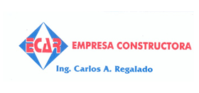
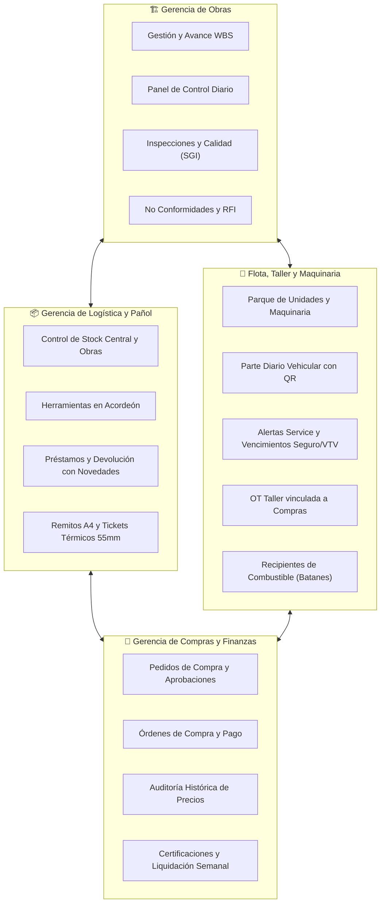
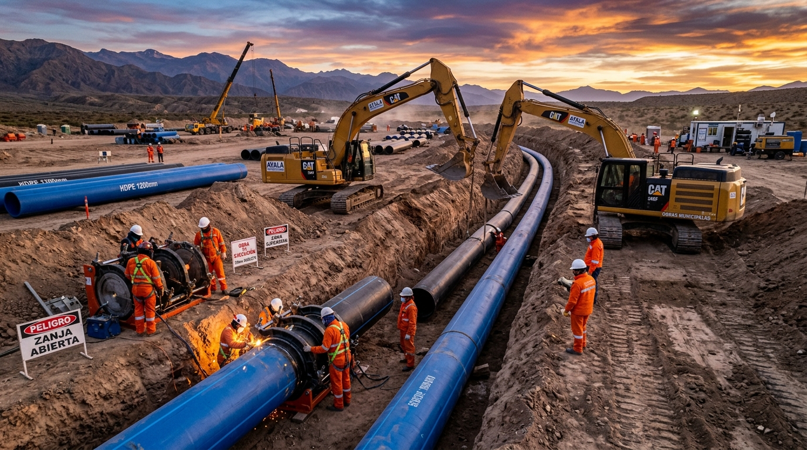
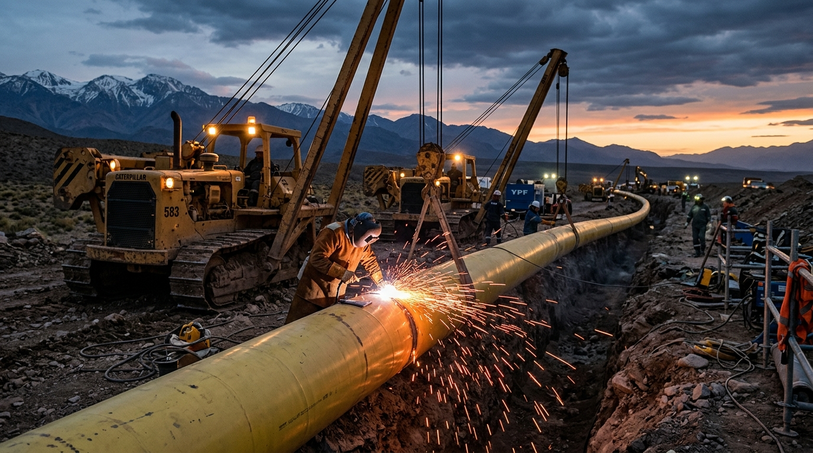
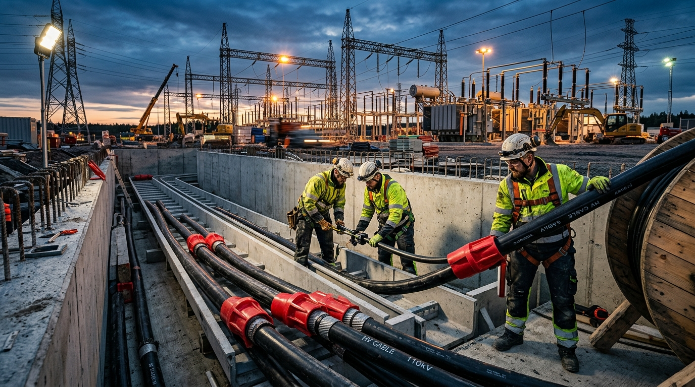
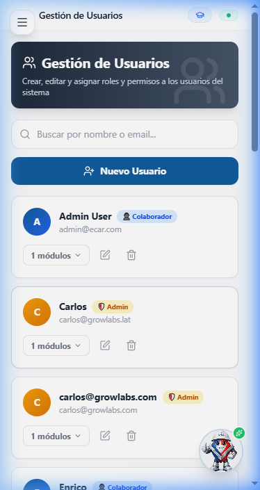
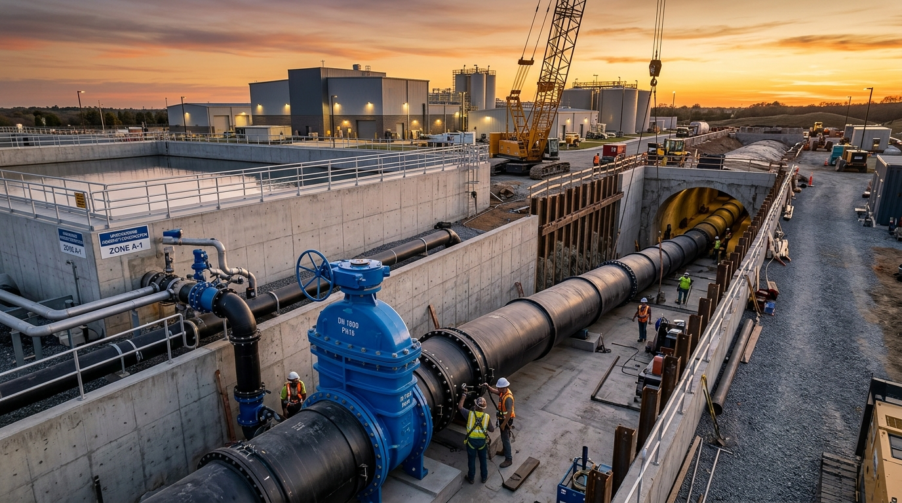

<div align="center">



# 🏗️ ECAR ERP · Sistema Integral de Gestión de Obras, Flota e Infraestructura

**Plataforma Cloud de Gestión Operativa, Logística, Financiera y Calidad para Empresas Constructoras y de Servicios de Infraestructura.**

[](https://vitejs.dev/)
[](https://react.dev/)
[](https://www.typescriptlang.org/)
[](https://tailwindcss.com/)
[](https://supabase.com/)
[](https://web.dev/progressive-web-apps/)

<p align="center">
  <a href="#-visión-general">Visión General</a> •
  <a href="#-módulos-del-sistema">Módulos</a> •
  <a href="#-cómo-funciona-la-arquitectura">Cómo Funciona</a> •
  <a href="#-ventajas-competitivas-del-sistema">Ventajas</a> •
  <a href="#-capturas-y-showcase">Showcase</a> •
  <a href="#-stack-tecnológico">Stack</a> •
  <a href="#-puesta-en-marcha">Instalación</a>
</p>

---

</div>

<p align="center">
  
</p>

---

## 📌 Visión General

**ECAR ERP** es un sistema integral de clase empresarial desarrollado específicamente para resolver los dolores críticos del sector de la **construcción pesada, redes de gas, saneamiento, obras eléctricas y obras civiles**.

Conecta en tiempo real la **obra en terreno** con los **pañoles de abastecimiento**, los **talleres de mantenimiento**, las **gerencias de compras** y la **administración financiera**, eliminando los desfasajes de stock, la pérdida de herramientas, la falta de control en el consumo de combustible y los baches documentales de la flota.

---

## 🎯 Módulos del Sistema



### 1. 🚛 Flota y Maquinaria
* **Tablero KPI de 1-Click:** Filtros instantáneos por *Total Unidades*, *Service al Día*, *Próximos a Vencer (7d / 500 km / 50 hs)*, *Service Vencido* y *Documentación Vencida*.
* **Auditoría Documental:** Detalle visible inmediato de qué documento está vencido (`Seguro` o `VTV`) con su fecha exacta.
* **Control Especial de Batanes (`BT-001` / `BT-002`):** Tratados como *Recipientes de Combustible*, exhibiendo Stock Actual (L) y Capacidad (L), excluidos de horómetros/odómetros y servicios por km.
* **Histórico y Métricas por Unidad:** Medición en **Kilómetros** (rodados) u **Horas** (maquinaria pesada), consumo específico (L/h y Km/L) y costo por km.

<p align="center">
  
</p>

### 2. 📋 Parte Diario Vehicular (Check-in Digital por QR)
* **Check-in Móvil con QR:** Cada vehículo cuenta con su código QR impreso en el parabrisas. Los choferes/operarios escanean y completan el parte antes de salir.
* **Inspección Física y Fotos:** Registro de kilometraje/horómetro, nivel de combustible, checklist de 10 puntos de seguridad y captura fotográfica de daños desde el celular.
* **Selector Rápido de Estado:** Distinción en 1-click entre *"Reportados Hoy"* y *"Pendientes sin Parte Hoy"*, con acceso directo para regularizar las unidades faltantes.
* **Detalle Centrado y Lightbox:** Visor de reportes modal con ampliación de fotografías en alta resolución para inspección técnica de averías.

### 3. 🔧 Taller y Mantenimiento Integrado con Compras
* **Órdenes de Trabajo (OT) con Enlace a Compras:** Creación de OT clasificadas en `Service`, `Repuestos`, `Neumáticos` u `Otros`, con desglose de ítems, cálculo automático de importes, proveedor sugerido y presupuesto adjunto.
* **Circuito de Aprobación Auditado:** `Borrador` ➔ `Enviada a Compras` ➔ `Aprobada / Rechazada` ➔ `Compra Realizada` ➔ `Cerrada`, sincronizado automáticamente con solicitudes de compra y con log histórico de cambios.
* **Confirmación de Service Seguro:** Modal de completado sin saltos de scroll que solicita fecha de ejecución, lectura actual de km/hs, lectura estimada del próximo service y observaciones de taller.

### 4. 🛠️ Pañol, Herramientas y Despacho de Materiales
* **Listado de Herramientas en Acordeón Inteligente:** Agrupación alfabética por familia (`ALICATES`, `AMOLADORAS`, `TALADROS`, etc.), colapsadas por defecto para navegación ultrarrápida.
* **Contadores de Disponibilidad en Tiempo Real:** Cabeceras con resumen inmediato: `[n] total · [n] disp. · [n] prestadas · [n] reparación`.
* **Préstamos Diarios y Devolución con Novedades:** Registro de quién retira cada máquina y opción de devolución normal o *con novedad (dañada)*, deshabilitando automáticamente la herramienta y enviándola a taller.
* **Remito Interno en Lote:** Selección múltiple de herramientas y materiales para asignación simultánea a una obra mediante un solo remito oficial.

<p align="center">
  
</p>

### 5. 🧾 Remitos Digitales y Ticket Térmico 55 mm
* **Doble Modalidad de Impresión:**
  * **Remito Formal A4 en PDF:** Para archivo administrativo, firmas legales de obra y auditoría contable.
  * **Ticket Térmico de 55 mm con QR:** Formato compacto de alta velocidad optimizado para impresoras térmicas de pañol (ancho útil 48–50 mm, monocromo, código QR de verificación rápida en destino).
* **Disponibilidad Total:** Accesible desde Logística, Despachos en Tránsito, Kardex de Egresos y el Modal de Remito Interno.

### 6. 🛒 Compras, Precios y Finanzas de Obra
* **Kardex y Variación de Precios:** Historial comparativo factura a factura, calculando diferencias absolutas en pesos (`$`) y porcentuales (`%`) para evitar desvíos inflacionarios en presupuestos.
* **Liquidación Semanal de Mano de Obra:** Módulo de control de jornales y pagos por cuadrilla/obra.
* **Seguimiento Presupuestario WBS:** Comparación entre presupuesto proyectado y gasto real incurrido por centro de costos.

---

## ⚙️ Cómo Funciona la Arquitectura

```
┌────────────────────────────────────────────────────────┐
│                   Cliente Web & PWA                    │
│   React 19 + TypeScript + Vite + Tailwind CSS v4       │
└───────────────────────────┬────────────────────────────┘
                            │ Queries / Mutations / Realtime
                            ▼
┌────────────────────────────────────────────────────────┐
│             Capa de Datos y Estado Local               │
│   • TanStack Query (Caché y Sincronización)            │
│   • Zustand (Estado Global y Modales)                  │
│   • jsPDF / html2canvas (Generador Documental)         │
└───────────────────────────┬────────────────────────────┘
                            │ REST / Postgres Websockets
                            ▼
┌────────────────────────────────────────────────────────┐
│              Backend as a Service (Supabase)           │
│   • Autenticación basada en Roles (RBAC)               │
│   • Base de Datos Relacional PostgreSQL                │
│   • Row Level Security (RLS) por Empresa/Obra          │
│   • Storage S3 Compatible (Fotos de Daños y Facturas)  │
└────────────────────────────────────────────────────────┘
```

1. **Operación en Terreno (Offline-First Ready):** El personal en obra o choferes registran partes, movimientos y solicitudes desde cualquier dispositivo móvil.
2. **Sincronización Inmediata:** Los datos impactan en PostgreSQL mediante TanStack Query, actualizando los tableros de compras, taller y stock sin recargar la página.
3. **Generación Documental Autónoma en Cliente:** Los remitos A4 y tickets térmicos de 55 mm se renderizan mediante funciones dedicadas en TypeScript ([`orderPdfExport.ts`](./src/lib/orderPdfExport.ts)), sin requerir servidores de impresión pesados.
4. **Navegación Determinística y Accesibilidad:** Implementa breadcrumbs inteligentes de 3 niveles (`ECAR › Gerencia › Módulo › Sub-vista`), botón `"← Volver"` predecible y contraste optimizado tanto en modo claro clínico como en modo oscuro.

---

## 🌟 Ventajas Competitivas del Sistema

| Desafío Típico en Obra | Solución de ECAR ERP | Beneficio Directo |
|---|---|---|
| **Pérdida y rotura de herramientas** | Trazabilidad unitaria con código de barras/serie y retorno con novedades físicas. | Reducción de hasta un 35 % en compras de reposición imprevistas. |
| **Vencimientos de VTV y Seguro en ruta** | Detección preventiva con badges de alerta y fecha exacta de vencimiento. | Cero multas, secuestros de vehículos o paralizaciones de transporte. |
| **Falta de enlace entre Taller y Compras** | Las OT de taller generan automáticamente el requerimiento en Compras con cotización y proveedor sugerido. | Tiempos de reparación reducidos a la mitad; compras autorizadas con respaldo. |
| **Descontrol en despacho de materiales** | Remito único digital + impresión térmica 55 mm con QR entregada en mano al chofer. | Control riguroso en recepción de obra; cero materiales "en el limbo". |
| **Pérdida de margen por inflación** | Auditoría automática de aumentos de precio factura por factura en el Kardex. | Alertas tempranas sobre variaciones en insumos críticos. |
| **Uso en ambientes rústicos de obra** | PWA instalable con interfaces limpias, botones táctiles grandes y contraste optimizado. | Adopción inmediata por parte de operarios y maquinistas sin curva de aprendizaje compleja. |

---

## 📸 Capturas y Showcase

<div align="center">

| Portada de Operaciones | Obras de Distribución y Redes |
|:---:|:---:|
|  |  |

| Control de Usuarios y Seguridad | Obras Hidráulicas y Plantas |
|:---:|:---:|
|  |  |

</div>

---

## 🛠️ Stack Tecnológico

* **Frontend:** [React 19](https://react.dev/), [TypeScript 5](https://www.typescriptlang.org/), [Vite 6](https://vitejs.dev/)
* **Estilos y Componentes:** [Tailwind CSS v4](https://tailwindcss.com/), [Lucide React Icons](https://lucide.dev/)
* **Gestión de Estado y Caché:** [TanStack Query v5](https://tanstack.com/query/latest), [Zustand](https://zustand-demo.pmnd.rs/)
* **Backend y Base de Datos:** [Supabase](https://supabase.com/) (PostgreSQL 15+, Auth, Storage, RLS)
* **Reportes y Documentos:** [jsPDF](https://github.com/parallax/jsPDF), [SheetJS (xlsx)](https://sheetjs.com/), [QRCode Generator](https://goqr.me/)
* **PWA & Offline:** [Vite PWA Plugin](https://vite-pwa-org.netlify.app/) con Workbox

---

## 🚀 Puesta en Marcha

### Requisitos Previos
* [Node.js](https://nodejs.org/) (versión 18 o superior recomendada)
* Gestor de paquetes `npm` o `pnpm`
* Proyecto activo en [Supabase](https://supabase.com/)

### 1. Clonar el repositorio
```bash
git clone https://github.com/lmarinero-sketch/ecar.git
cd ecar
```

### 2. Instalar dependencias
```bash
npm install
```

### 3. Configurar variables de entorno
Crear un archivo `.env` en la raíz del proyecto basándose en las variables de conexión a Supabase:
```env
VITE_SUPABASE_URL=https://tu-proyecto.supabase.co
VITE_SUPABASE_ANON_KEY=tu-clave-anonima-publica
```

### 4. Ejecutar en modo desarrollo
```bash
npm run dev
```
La aplicación iniciará en `http://localhost:5173`.

### 5. Compilación para producción
```bash
npm run build
```
Genera la carpeta optimizada `dist/` con Service Worker registrado y assets listos para desplegar en Netlify, Vercel o servidor privado.

---

<div align="center">

Desarrollado para **ECAR** • Potenciado por **Grow Labs**

</div>
